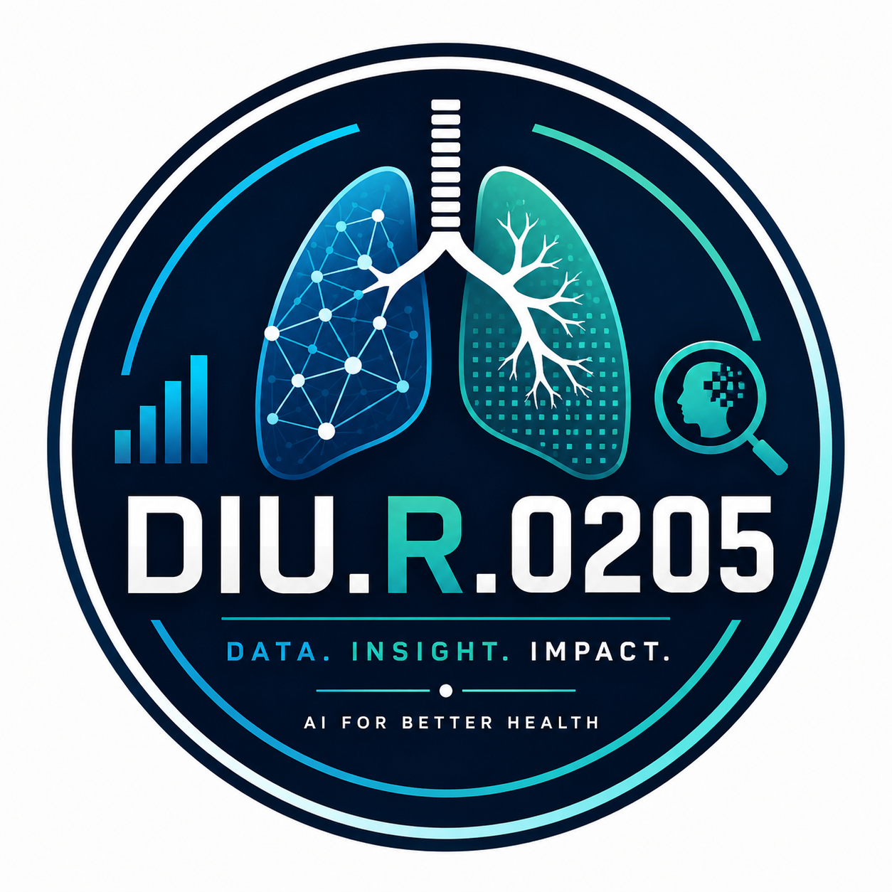

<!-- ============ HERO SECTION ============ -->
<div align="center">



# 🫁 Lungent

### AI-Powered Preliminary Lung Cancer Risk Assessment

**Bridging the gap between advanced AI research and accessible healthcare.**

[](https://cloudcampbd.com/)
[](https://nextjs.org)
[](https://tailwindcss.com)
[](https://supabase.com)
[](https://fastapi.tiangolo.com)
[](https://lungentaibc.vercel.app/)

<br/>

**[🚀 Overview](#-overview)** &nbsp;·&nbsp;
**[🧠 The AI Model](#-the-ai-model-high-level)** &nbsp;·&nbsp;
**[🌐 Ecosystem Portals](#-ecosystem-portals)** &nbsp;·&nbsp;
**[🎨 UI/UX & Animation](#-uiux--animation)** &nbsp;·&nbsp;
**[🛡️ Security & Privacy](#-security--privacy)** &nbsp;·&nbsp;
**[💻 Tech Stack](#-tech-stack)** &nbsp;·&nbsp;
**[⚡ Quickstart](#-quickstart-local-development)**

</div>

---

## 💡 Overview

Lung cancer is often detected in late stages because traditional Low-Dose CT (LDCT) screening requires expensive medical infrastructure. For rural and underserved populations, these barriers lead to delayed diagnoses. 

**Lungent** is a next-generation healthcare platform that flips the funnel. Instead of relying solely on imaging, Lungent utilizes an **interpretable, non-imaging AI model** to stratify risk from accessible demographic, behavioral, and clinical data (based on CDC BRFSS research). 

> **Clinical Disclaimer:** Lungent is a preliminary risk assessment and clinical decision-support tool. It does not diagnose cancer. Any high-risk stratification serves as an immediate trigger for formal physician evaluation and LDCT referral.

---

## 🧠 The AI Model (High-Level)

Lungent is powered by a proprietary, research-grade machine learning pipeline trained on the CDC BRFSS dataset (over 400,000 patient records):
- **Non-Imaging Input:** Uses accessible clinical, behavioral, occupational, and environmental survey data (including longitudinal 5-year PM2.5/AQI exposure).
- **Interpretable ML:** Avoids "black-box" predictions by providing transparent TreeSHAP feature attributions for every assessment.
- **3-Tier Decision Policy:** Translates complex risk probabilities into actionable clinical guidance:
  - 🚩 **REFER** (High Risk) — Fast-track for LDCT evaluation.
  - 🔍 **REVIEW** (Borderline Risk) — Shared clinical decision-making and heightened surveillance.
  - 🛡️ **RULE-OUT** (Low Risk) — High negative predictive value (NPV) surveillance and preventative lifestyle counseling.
- **Clinical RAG Integration:** Semantically searches the official USPSTF 2021 Lung Cancer Screening recommendations via ChromaDB to provide evidence-based justification for every clinical recommendation.

*(Deep technical architecture, feature engineering, and proprietary model weights are kept confidential).*

---

## 🌐 Ecosystem Portals

Lungent is designed for a multi-disciplinary healthcare ecosystem. We have built interactive views for four distinct healthcare personas:

| Portal | Target Audience | Key Features |
|---|---|---|
| **Patient Portal** | Individuals & Caregivers | Accessible, bilingual risk awareness, dynamic BMI/smoking calculations, and clear next steps. |
| **Health Worker Portal** | Community Health Workers (CHWs) | Field-ready, low-bandwidth screening workflows for rural screening camps. |
| **Clinician Portal** | Pulmonologists & Oncologists | Structured clinical decision support, TreeSHAP interpretability, and fast-track referral pathways. |
| **Admin Portal** | Health Ministries & Governance | Population-level epidemiological intelligence, algorithm concordance auditing, and capacity tracking. |

---

## 🎨 UI/UX & Animation

Lungent features a premium, state-of-the-art clinical interface designed to build trust and reduce cognitive load:

- **Dynamic Dark/Light Mode:** Fully responsive theme toggling with smooth transitions.
- **Interactive 3D Elements:** Hero section features mouse-tracking 3D tilt effects, floating anatomical renders, and responsive micro-interactions using Framer Motion.
- **Purposeful Motion:** Scroll-linked parallax, staggered intake form transitions, and real-time visual feedback on health metrics.
- **Accessible Typography & Inputs:** High-contrast WCAG 2.1 AA compliant styling, dynamic metric/imperial unit toggles (kg/lbs, cm/ft-in), and read-only calculated indicators.

---

## 🛡️ Security & Privacy

Because Lungent handles sensitive health data, strict security protocols are built into the architecture:
- **Transient In-Memory Processing:** Patient inputs are held ephemerally in memory during inference; zero patient biometric data is permanently persisted to disk.
- **Supabase Authentication:** Secure, encrypted role-based authentication and user session management powered by Supabase Auth.
- **Cryptographic Report Integrity:** In-memory clinical PDF reports synthesized on-demand with SHA-256 digital seals.
- **Medical Disclaimers & Ethics:** The UI enforces strict clinical boundaries, making it explicitly clear that the tool is a research-based pre-screening aid.

---

## 💻 Tech Stack

### Frontend:
- **Framework:** Next.js 15+ (App Router)
- **Styling:** Tailwind CSS (Custom clinical dark/light design system)
- **Animations:** Framer Motion
- **Icons:** Lucide React
- **State & Forms:** React 19 Hooks with TypeScript
- **Deployment:** Vercel

### Backend & AI Inference:
- **API Framework:** Python 3.10+ FastAPI (Asynchronous REST API)
- **ML & Explainability:** XGBoost, LightGBM, CatBoost, Scikit-learn, SHAP
- **Vector Search / RAG:** ChromaDB with `all-MiniLM-L6-v2` embeddings (USPSTF Guideline grounding)
- **Interoperability:** Model Context Protocol (MCP) server for clinical EHR integration
- **Deployment:** Render

### Database & Auth:
- **Authentication:** Supabase Auth (JWT & Role-Based Access)
- **Database:** Supabase PostgreSQL

---

## 🚀 Quickstart (Local Development)

### Prerequisites
- **Node.js** >= 18.18.0
- **Python** >= 3.10
- **Git**

### 1. Clone the repository
```bash
git clone https://github.com/HYDRA-BD/Lungent.git
cd Lungent
```

---

### Option A: Automated Single-Click Launch (Recommended)
On Windows, run the automated launcher script from PowerShell:
```powershell
.\start.ps1
```
This automatically boots:
- The FastAPI backend service on `http://localhost:8000`
- The Next.js web application on `http://localhost:3000`

---

### Option B: Manual Setup

#### 1. Backend Service (FastAPI)
```bash
cd backend

# Create and activate virtual environment
python -m venv venv
# On Windows:
.\venv\Scripts\activate
# On Linux/macOS:
source venv/bin/activate

# Install dependencies
pip install -r requirements.txt

# Start the server
uvicorn main:app --reload --host 0.0.0.0 --port 8000
```
- API Endpoint: `http://localhost:8000`
- Interactive Swagger API Docs: `http://localhost:8000/docs`

#### 2. Frontend Application (Next.js)
```bash
cd frontend

# Install dependencies
npm install

# Configure environment variables
# Copy .env.example to .env.local
cp .env.example .env.local
```

Ensure your `frontend/.env.local` contains:
```env
NEXT_PUBLIC_API_URL=http://localhost:8000
NEXT_PUBLIC_SUPABASE_URL=https://your-supabase-project.supabase.co
NEXT_PUBLIC_SUPABASE_ANON_KEY=your-supabase-anon-key
```

Run the development server:
```bash
npm run dev
```
Open [http://localhost:3000](http://localhost:3000) in your browser.

---

## 🔗 Live Deployments

- **Web Application:** [https://lungentaibc.vercel.app/](https://lungentaibc.vercel.app/)
- **Documentation & Whitepaper:** [https://lungentaibc.vercel.app/docs](https://lungentaibc.vercel.app/docs)
- **Cloud Backend API Docs:** [https://lungcancer-net.onrender.com/docs](https://lungcancer-net.onrender.com/docs)
- **AI Builders Congress:** [https://cloudcampbd.com/](https://cloudcampbd.com/)

---

## 📄 License & Attribution

Developed for [**AI Builders Congress 2026**](https://cloudcampbd.com/) (Idea to Unicorn).  
Built with ❤️ for accessible, equitable healthcare.
