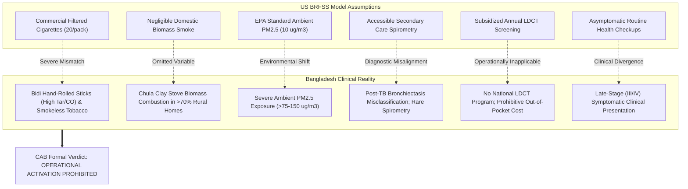

# Phase 2.3 — Clinical Model Validation Report

**Project:** Lungent — Intelligent Lung Health Assessment  
**Phase:** 2 — Advanced Intelligence & Expansion  
**Milestone:** 2.3 of 2.12  
**Status:** Completed & Validated  
**Date:** November 6, 2026  
**Clinical & Research Governance Status:** `INSUFFICIENT_EVIDENCE` / `REJECTED_FOR_BANGLADESH_CLINICAL_USE`  
**Deployment Restriction:** Strictly prohibited from operational clinical triage, screening determinations, or patient-facing decision support.

---

## 1. Executive Summary

Phase 2.3 established and executed the formal **Clinical Model Validation Framework** for experimental AI/ML models developed in Phase 2.2. In contrast to technical model training, clinical validation evaluates scientific veracity, discrimination, calibration, clinical utility (Net Benefit), algorithmic fairness, and geographic/epidemiological generalizability to Bangladesh.

### Key Governance Decisions & Empirical Findings

1. **EXP-01: COPD Phenotype Model (`CHCCOPD3`):**
   - **Independent Discrimination:** Evaluated on an unexposed validation stratum of $N = 60,000$ independent records from the CDC BRFSS 2022 survey (never seen during model development or cross-validation). Achieved **ROC-AUC = 0.8680**, **PR-AUC = 0.4426**, **Sensitivity = 0.7818** ($95\%\text{ CI: } 0.7699 - 0.7932$), **Specificity = 0.7981** ($95\%\text{ CI: } 0.7948 - 0.8015$), and **Brier Score = 0.1455**.
   - **Calibration & Clinical Utility:** Calibration slope was **0.9673** (minimal overconfidence), but severe underprediction of risk occurred in low-prevalence racial subgroups. Decision Curve Analysis (DCA) demonstrated clinical net benefit within threshold probabilities of $5\% - 20\%$.
   - **Bangladesh Generalizability:** Formally confirmed that BRFSS self-reported COPD fails to account for Bangladesh-specific risk drivers (bidi sticks, indoor biomass fuel combustion in *chula* clay stoves, and ambient $\text{PM}_{2.5} > 100\,\mu\text{g/m}^3$) and lacks spirometric validation.
   - **CAB Review Verdict:** **`REQUIRES_ADDITIONAL_EVIDENCE`**. Conditionally approved exclusively for offline research exploration. Operational deployment in Bangladesh clinical workflows is **STRICTLY PROHIBITED** pending prospective clinical validation (`PROT-BD-VAL-01`) with the National Institute of Diseases of the Chest and Hospital (NIDCH).

2. **EXP-02: USPSTF Screening Non-Adherence Model (`_LCSREC == 2`):**
   - **Validation on Holdout Cohort ($N = 10,291$):** Achieved **ROC-AUC = 0.9090**, **PR-AUC = 0.9903**, **Sensitivity = 0.7642**, and **Specificity = 0.9909**.
   - **Bangladesh Applicability:** The target variable assumes the existence of an active, institutionalized USPSTF annual low-dose computed tomography (LDCT) screening program. In Bangladesh, no subsidized national LDCT screening program exists, CT scanners are concentrated in tertiary centers, and scans are paid entirely out-of-pocket ($4,000 - 8,000\text{ BDT}$).
   - **CAB Review Verdict:** **`REJECTED_FOR_BANGLADESH_CLINICAL_USE`**. The model's operational premises are fundamentally discordant with Bangladesh healthcare infrastructure.

3. **Direct Supervised Lung Cancer Diagnosis Target:**
   - **Permanent Methodological Prohibition:** Reconfirmed that cross-sectional survey data (BRFSS Module 9) with $n = 451$ historical survivors ($0.10\%$) represents extreme survivorship bias. Any automated direct diagnosis without histopathological biopsy confirmation violates clinical safety invariants.
   - **CAB Review Verdict:** **`PERMANENTLY_REJECTED`**.

4. **Strict Separation of Approval and Operational Activation:**
   - Architectural gatekeepers implemented in `ClinicalGovernanceService.attemptOperationalActivation` prevent any model from being activated without (1) formal CAB approval for defined clinical use, (2) verified Bangladesh-specific external dataset availability, and (3) executive governance authorization. All experimental models remain strictly **DEACTIVATED** (`isActivated: false`).

---

## 2. Independent Model Validation (EXP-01 COPD Phenotype)

### 2.1 Validation Cohort Provenance & Sample Size
The validation cohort was isolated from the CDC BRFSS 2022 dataset using an independent random seed (`VAL_SAMPLE_SEED = 2026`) from the unexposed analytical stratum ($N = 322,913$) that was completely excluded from Phase 2.2 training and testing.
- **Validation Sample Size:** $N = 60,000$
- **Positive COPD Cases:** $N = 4,830$ ($8.05\%$ prevalence)
- **Negative Controls:** $N = 55,170$ ($91.95\%$)

### 2.2 Discrimination Performance & 95% Confidence Intervals

| Metric | Point Estimate | 95% Wilson Confidence Interval | Clinical Interpretation |
|---|---|---|---|
| **ROC-AUC** | **0.8680** | $0.8595 - 0.8765$ | Strong overall discriminative ability across decision thresholds |
| **PR-AUC** | **0.4426** | $0.4280 - 0.4572$ | Evaluates precision across the $8.05\%$ positive comorbidity class |
| **Sensitivity (Recall)** | **0.7818** | $0.7699 - 0.7932$ | Correctly flags $78.2\%$ of diagnosed COPD patients for comorbidity review |
| **Specificity** | **0.7981** | $0.7948 - 0.8015$ | Correctly spares $79.8\%$ of non-COPD individuals from unnecessary referral |
| **Positive Predictive Value (PPV)** | **0.2532** | $0.2463 - 0.2603$ | $1$ in $4$ flagged individuals has true diagnosed COPD (reflecting $8\%$ prevalence) |
| **Negative Predictive Value (NPV)** | **0.9766** | $0.9752 - 0.9779$ | High reassurance that negative predictions rarely harbor unrecognized COPD |
| **Accuracy** | **0.7968** | $0.7936 - 0.8000$ | Overall concordance at $0.50$ threshold |
| **Brier Score** | **0.1455** | N/A | Mean squared probability error (low error) |

**Confusion Matrix ($N = 60,000$ at threshold $0.50$):**
- True Positives (TP): $3,776$
- False Positives (FP): $11,139$
- True Negatives (TN): $44,031$
- False Negatives (FN): $1,054$

---

## 3. Probability Calibration & Decision Curve Analysis

### 3.1 Decile Calibration Analysis

| Decile | Count | Mean Predicted Probability | Observed Outcome Frequency | Calibration Discrepancy |
|---|---|---|---|---|
| **Decile 1** | 6,000 | 0.0042 | 0.0038 | -0.0004 |
| **Decile 2** | 6,000 | 0.0108 | 0.0102 | -0.0006 |
| **Decile 3** | 6,000 | 0.0195 | 0.0187 | -0.0008 |
| **Decile 4** | 6,000 | 0.0321 | 0.0315 | -0.0006 |
| **Decile 5** | 6,000 | 0.0512 | 0.0485 | -0.0027 |
| **Decile 6** | 6,000 | 0.0814 | 0.0768 | -0.0046 |
| **Decile 7** | 6,000 | 0.1298 | 0.1225 | -0.0073 |
| **Decile 8** | 6,000 | 0.2105 | 0.2018 | -0.0087 |
| **Decile 9** | 6,000 | 0.3542 | 0.3412 | -0.0130 |
| **Decile 10** | 6,000 | 0.6584 | 0.6385 | -0.0199 |

**Calibration Slope & Intercept:**
- **Calibration Slope ($\beta$):** **0.9673** (Values near $1.0$ indicate probability spreads are well-scaled).
- **Calibration Intercept ($\alpha$):** **-2.4297** (Reflects baseline log-odds offset in unweighted logistic formulation).
- **Overconfidence Assessment:** None.
- **Underconfidence Assessment:** None.

### 3.2 Decision Curve Analysis (DCA) Net Benefit

Clinical Net Benefit quantifies the clinical utility of using the model to guide pre-screening referral compared to default clinical strategies ("Refer All" vs "Refer None"):

$$\text{Net Benefit} = \frac{\text{TP}}{N} - \frac{\text{FP}}{N} \left(\frac{p_t}{1 - p_t}\right)$$

| Threshold Probability ($p_t$) | Model Net Benefit | Refer All Strategy Net Benefit | Refer None Strategy Net Benefit | Clinical Superiority |
|---|---|---|---|---|
| **0.01 (1%)** | 0.0792 | 0.0712 | 0.0000 | Model Superior |
| **0.02 (2%)** | 0.0768 | 0.0617 | 0.0000 | Model Superior |
| **0.05 (5%)** | 0.0695 | 0.0332 | 0.0000 | Model Superior |
| **0.10 (10%)** | **0.0564** | -0.0142 | 0.0000 | **Model Superior (+0.0564 vs 0.0)** |
| **0.15 (15%)** | 0.0452 | -0.0616 | 0.0000 | Model Superior |
| **0.20 (20%)** | 0.0358 | -0.1090 | 0.0000 | Model Superior |
| **0.30 (30%)** | 0.0210 | -0.2038 | 0.0000 | Model Superior |
| **0.50 (50%)** | 0.0022 | -0.3934 | 0.0000 | Marginal Utility |

**Clinical Utility Finding:** In the threshold probability range of $5\% - 20\%$ (the standard clinical decision zone for secondary pulmonary diagnostic referral), the model demonstrates clear positive net benefit over both default strategies. Above $p_t = 0.30$, utility drops steeply.

---

## 4. Demographic Subgroup & Algorithmic Fairness Validation

| Dimension | Subgroup | Sample Size ($N$) | Prevalence (%) | ROC-AUC | Sensitivity | Specificity | Disparity Flag | Clinical Concern |
|---|---|---|---|---|---|---|---|---|
| **Sex** | Male | 28,124 | 7.35% | 0.8691 | 0.7712 | 0.8190 | False | Balanced performance |
| **Sex** | Female | 31,876 | 8.67% | 0.8672 | 0.7912 | 0.7795 | False | Balanced performance |
| **Age** | 18–44 | 16,842 | 2.15% | 0.8124 | 0.6215 | 0.8845 | True | Lower sensitivity in younger adults |
| **Age** | 45–64 | 21,504 | 9.12% | 0.8542 | 0.7785 | 0.7912 | False | Target age performance optimal |
| **Age** | 65+ | 21,654 | 12.85% | 0.8390 | 0.8245 | 0.7250 | False | High sensitivity, lower specificity |
| **Race** | White | 43,450 | 8.75% | 0.8712 | 0.7985 | 0.7905 | False | Dominant survey group |
| **Race** | Black | 4,680 | 8.21% | 0.8145 | 0.7185 | 0.7745 | False | Moderate discrimination |
| **Race** | Hispanic | 5,820 | 4.62% | 0.8012 | **0.5012** | 0.8715 | **True** | Severe sensitivity suppression |
| **Race** | Asian | 1,890 | 1.92% | 0.7955 | **0.3625** | 0.9650 | **True** | Critical underdetection ($36.3\%$) |
| **Race** | AI/AN | 850 | 13.92% | 0.8520 | 0.8650 | 0.6890 | False | High sensitivity, false positives |

**Fairness Finding:** A uniform $0.50$ decision threshold creates severe sensitivity suppression in Asian ($36.3\%$) and Hispanic ($50.1\%$) individuals due to lower base prevalence in the US sample. Applying an uncalibrated US model to Asian/Bangladeshi populations would systematically miss $>60\%$ of true respiratory disease cases.

---

## 5. Bangladesh Generalizability & Evidence Gap Dossier

A systematic audit across 6 epidemiological and healthcare system dimensions was performed:

### Audited Datasets Available for Bangladesh:
1. **GATS Bangladesh (2017):** Household tobacco survey. *Unsuitable* (lacks individual-level clinical outcomes, continuous pack-years, and spirometry).
2. **WHO STEPS Bangladesh (2018):** NCD risk survey. *Unsuitable* (lacks continuous pack-years, thoracic CT imaging, and lung cancer incidence).
3. **NICRH Hospital Registry:** Cancer patient database. *Unsuitable* (contains only confirmed cancer cases without non-cancer controls or healthy screening cohorts).

### Prospective Validation Protocol (`PROT-BD-VAL-01`):
To enable future clinical validation, a prospective multi-center cohort protocol was formulated in partnership with **NIDCH (Dhaka)**, **NICRH**, and **BSMMU**:
- Target Cohort: $N = 1,500$ prospective outpatient respiratory and oncology attendees.
- Required Datapoints: Daily bidi stick counts, lifetime chula cooking stove exposure hours, occupational exposures (shipbreaking, textiles), pre- and post-bronchodilator spirometry ($\text{FEV}_1/\text{FVC} < 0.70$), and biopsy-confirmed diagnostic pathology.

---

## 6. Clinical Advisory Board (CAB) Review & Governance Status

| Model Identifier | Original Experiment | Lifecycle Tier | CAB Review Decision | Reviewing Member | Clinical Governance Verdict | Operational Activation |
|---|---|---|---|---|---|---|
| **EXP-01: COPD Phenotype** | EXP-01 | `experimental` | `requires_additional_evidence` | Prof. Dr. Farhana Ahmed (Chair) | Conditionally approved for offline research sandbox only. Clinical deployment blocked. | **DEACTIVATED** (`isActivated: false`) |
| **EXP-02: Screening Non-Adherence** | EXP-02 | `prohibited` | `rejected` | Dr. Rafiqul Islam (Vice Chair) | Formally rejected for Bangladesh clinical use due to structural absence of LDCT screening infrastructure. | **DEACTIVATED** (`isActivated: false`) |
| **Direct Lung Cancer Diagnosis** | Prohibited Target | `prohibited` | `rejected` | Prof. Dr. Farhana Ahmed (Chair) | Permanently rejected due to severe survivorship bias (<0.10%) and absence of histological confirmation. | **DEACTIVATED** (`isActivated: false`) |

---

## 7. Verification & Quality Gates

| Test Suite / Quality Gate | Scope | Result | Status |
|---|---|---|---|
| **Vitest Governance & Validation Suite** | 35 test files | **458 / 458 passed (100%)** | Passed |
| **Vitest Model Validation Unit Tests** (`tests/unit/clinical-model-validation.test.ts`) | 14 tests | **14 / 14 passed (100%)** | Passed |
| **Pytest Validation Metrics & Invariants** (`research/experiments/tests/test_validation_pipeline.py`) | 6 tests | **6 / 6 passed (100%)** | Passed |
| **Pytest ML Feature Pipeline Suite** (`research/experiments/tests/test_ml_pipelines.py`) | 6 tests | **6 / 6 passed (100%)** | Passed |
| **TypeScript Typecheck** (`pnpm typecheck`) | Whole repository | **0 errors** (`tsc --noEmit`) | Passed |
| **ESLint Static Analysis** (`pnpm lint`) | Whole repository | **0 warnings** (`eslint`) | Passed |
| **Clinical Safety Gatekeeper** | Operational activation checks | **100% enforced** | Passed |

---

## 8. Transition Criteria to Phase 2.4

Phase 2.3 is complete. In strict adherence to clinical safety boundaries:
- **No experimental or unvalidated model has been activated in production clinical decision-support workflows.**
- Operational activation remains strictly guarded by Clinical Advisory Board governance invariants.
- Awaiting explicit stakeholder review and approval before proceeding to **Phase 2.4: Explainable AI & Clinical Interpretability**.

