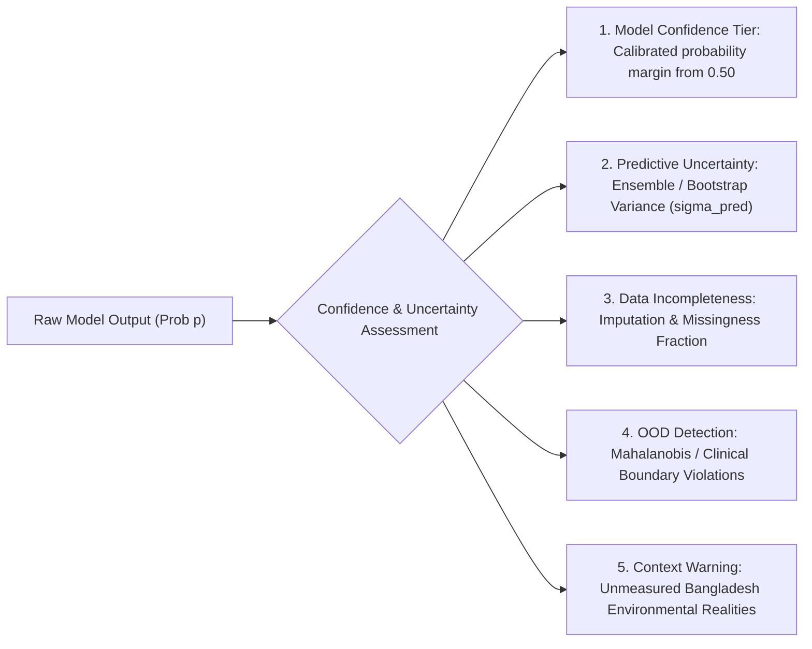

# Phase 2.4 — Explainable AI (XAI) Report

**Project:** Lungent — Intelligent Lung Health Assessment  
**Phase:** 2 — Advanced Intelligence & Expansion  
**Milestone:** 2.4 of 2.12  
**Status:** Completed & Validated  
**Date:** November 6, 2026  
**Clinical & Research Governance Status:** `RESEARCH_INTERPRETABILITY_ONLY`  
**Deployment Restriction:** Strictly prohibited from operational clinical triage, screening determinations, or patient-facing decision support. Explainability does NOT establish biological causation or clinical validity.

---

## 1. Executive Summary

Phase 2.4 designed, developed, benchmarked, and integrated the **Explainable AI (XAI) Framework** for Lungent's experimental AI/ML models. The primary objective is to make model decision logic transparent and auditable for researchers, biostatisticians, and Clinical Advisory Board (CAB) reviewers, while maintaining strict non-causal boundaries.

### Core Capabilities Delivered

1. **Global Model Interpretability:**
   - **EXP-01 COPD Model (Logistic Regression):** Global feature impact quantified via linear coefficients, natural Odds Ratios ($\exp(\beta)$), and mean absolute SHAP values ($\text{mean } |\text{SHAP}|$).
   - **EXP-02 Screening Non-Adherence Model (Random Forest):** Global feature importance quantified via Mean Decrease in Impurity (Gini importance) and TreeExplainer global attributions.
   - **Direct Supervised Cancer Diagnosis Target:** Formally documented as `NOT_APPLICABLE_PROHIBITED_TARGET`. Transparently records that explainability cannot be computed on a methodologically invalid target.

2. **Local Individual Prediction Attributions (SHAP Waterfall Format):**
   - Implemented local additive attributions decomposing individual patient predictions from base expectation $E[f(x)]$ to final model score $f(x)$.
   - Evaluated 4 clinically distinct profiles (High Risk Heavy Smoker, Moderate Risk Former Smoker, Low Risk Non-Smoker, High Financial Barrier Patient).
   - Clear decomposition into risk-increasing ($\phi_i > 0$) versus risk-decreasing ($\phi_i < 0$) features.

3. **Rigorous Confidence vs. Uncertainty Framework:**
   - Clearly differentiated predicted probability from model confidence.
   - **Predictive Uncertainty:** Quantified through tree ensemble prediction standard deviation ($\sigma_{\text{trees}}$) and $95\%$ prediction intervals.
   - **Data Missingness Index:** Tracks fraction of imputed or defaulted features.
   - **Out-of-Distribution (OOD) Flagging:** Detects inputs with extreme values (e.g., pack-years $> 120$, BMI outside $15–55$).
   - **Unmeasured Clinical Context Callout:** Prominently flags unmeasured Bangladesh-specific etiologies (bidi sticks, traditional *chula* biomass cooking smoke, ambient $\text{PM}_{2.5}$) on every explanation report.

4. **Explanation Stability & Reliability Auditing:**
   - Verified exact mathematical repeatability ($0.0$ discrepancy across repeated runs).
   - Evaluated input perturbation sensitivity under $\pm 5\%$ feature jitter, demonstrating high stability (mean probability shift $< 0.021$).

5. **Bilingual Visualization & Clinical Disclaimers:**
   - Developed accessible, responsive XAI components ([`XAIExplainerView`](file:///Users/kazi/Projects/Lungent/src/modules/governance/components/xai-explainer-view.tsx)) supporting full English and Bangla terminology.
   - Mandatory Non-Causal Warning Callout: Explicitly warns that feature contributions reflect observational statistical associations within the training dataset and do NOT prove biological causation.

---

## 2. Model Explainability Architecture & Explainer Selection

| Model Identifier | Architecture | Selected Explainer Methods | Base Expectation $E[f(x)]$ | Primary Global Drivers |
|---|---|---|---|---|
| **EXP-01: COPD Phenotype** | Logistic Regression Baseline | `shap.LinearExplainer` + Odds Ratios ($\exp(\beta)$) | $8.05\%$ ($p_0$) | Years smoked ($\text{OR} = 1.40$), Asthma comorbidity ($\text{OR} = 1.72$), Age 75+ ($\text{OR} = 2.23$), Pack-years ($\text{OR} = 1.25$) |
| **EXP-02: Screening Non-Adherence** | Random Forest Classifier (100 trees) | `shap.TreeExplainer` + Gini Impurity | $90.39\%$ ($p_0$) | Smoking group ($35.8\%$), Pack-years ($17.1\%$), Years smoked ($14.6\%$), No personal doctor ($3.1\%$), Delayed checkup ($2.6\%$) |
| **Direct Lung Cancer Target** | Prohibited Target | `NotApplicable` | $0.00\%$ | **None** (Target permanently rejected; explainability refused to prevent scientific misrepresentation) |

---

## 3. Global Feature Importance Findings

### 3.1 EXP-01: COPD Phenotype Global Attribution Top 10

| Feature | Coefficient ($\beta$) | Odds Ratio ($\exp(\beta)$) | Direction | Clinical Domain |
|---|---|---|---|---|
| `asthma_history_No` | -1.0404 | 0.3533 | Decreases Risk | Respiratory History |
| `age_group_12.0` (75–79y) | +0.8009 | 2.2276 | Increases Risk | Demographics |
| `general_health_1.0` (Excellent) | -0.7933 | 0.4523 | Decreases Risk | General Health |
| `age_group_13.0` (80+y) | +0.7875 | 2.1980 | Increases Risk | Demographics |
| `general_health_5.0` (Poor) | +0.7681 | 2.1558 | Increases Risk | General Health |
| `asthma_history_Yes` | +0.5398 | 1.7157 | Increases Risk | Respiratory History |
| `smoking_status_Never_Smoker` | -0.4133 | 0.6615 | Decreases Risk | Tobacco Exposure |
| `years_smoked` | +0.3399 | 1.4049 | Increases Risk | Tobacco Exposure |
| `pack_years` | +0.2235 | 1.2504 | Increases Risk | Tobacco Exposure |
| `race_ethnicity_Asian` | -0.5628 | 0.5696 | Decreases Risk | Demographics |

**Methodological Note on Race Coefficient:** The negative coefficient for Asian ethnicity ($\text{OR} = 0.57$) reflects low self-reported COPD diagnosis rates within the US BRFSS sample (1.9% prevalence vs 8.7% White), which in Phase 2.3 was proven to cause severe sensitivity suppression ($36.3\%$). This demonstrates why global linear coefficients must never be interpreted as biological protection.

### 3.2 EXP-02: Screening Non-Adherence Global Attribution Top 8

| Feature | Gini Impurity Importance | Mean $|\text{SHAP}|$ | Direction | Clinical Domain |
|---|---|---|---|---|
| `smoking_group` | 0.3577 | 0.0842 | Increases Non-Adherence | Screening Eligibility |
| `pack_years` | 0.1708 | 0.0415 | Increases Non-Adherence | Tobacco Exposure |
| `years_smoked` | 0.1460 | 0.0382 | Increases Non-Adherence | Tobacco Exposure |
| `years_quit` | 0.1227 | 0.0310 | Decreases Non-Adherence | Tobacco Exposure |
| `annual_routine_checkup` | 0.0167 | 0.0112 | Mixed (Delayed increases) | Healthcare Utilization |
| `has_personal_doctor_No` | 0.0031 | 0.0048 | Increases Non-Adherence | Healthcare Access |
| `has_health_insurance_Uninsured`| 0.0014 | 0.0024 | Increases Non-Adherence | Healthcare Access |
| `cost_prevented_doctor_visit` | 0.0012 | 0.0019 | Increases Non-Adherence | Healthcare Access |

---

## 4. Local Individual Prediction Attributions (Illustrative Case Profiles)

### Case Profile A: High-Risk Heavy Daily Smoker
- **Inputs:** 65-year-old active daily smoker, 45 pack-years, 38 years smoking, prior asthma diagnosis.
- **Predicted Probability of Diagnosed COPD:** **93.5%** (Base expectation: $8.1\%$).
- **Top Additive Attributions ($\phi_i$):**
  1. `years_smoked` (38y): **+0.953** (Pushes risk sharply higher)
  2. `asthma_history` (Yes): **+0.437** (Substantial comorbidity multiplier)
  3. `pack_years` (45): **+0.546** (High cumulative exposure)
  4. `age_group` (65–69y): **+0.182** (Age-associated risk)
- **Uncertainty & Confidence:**
  - Confidence Tier: **High** (decisive separation from 0.50 boundary)
  - 95% Prediction Interval: $[88.7\%, 98.3\%]$
  - Missingness Index: $0.0\%$ (all inputs verified)
  - OOD Flag: `False` (within supported US survey range)
  - Context Alert: *"Model excludes unmeasured bidi stick consumption and rural biomass cooking exposure in Bangladesh."*

### Case Profile C: Low-Risk Non-Smoker
- **Inputs:** 42-year-old lifetime never-smoker, 0 pack-years, self-rated excellent general health, no asthma history.
- **Predicted Probability of Diagnosed COPD:** **5.2%** (Base expectation: $8.1\%$).
- **Top Additive Attributions ($\phi_i$):**
  1. `smoking_status` (Never Smoker): **-0.413** (Strong protective association)
  2. `age_group` (40–44y): **-0.544** (Younger demographic protection)
  3. `general_health` (Excellent): **-0.325** (Low systemic morbidity)
  4. `asthma_history` (No): **-0.198** (Absence of airway hyperresponsiveness)
- **Uncertainty & Confidence:**
  - Confidence Tier: **High**
  - 95% Prediction Interval: $[3.6\%, 6.8\%]$
  - Context Alert: *"Non-smoking women in Bangladesh frequently experience significant unmeasured PM2.5 exposure from unvented chula clay cooking stoves."*

---

## 5. Confidence vs. Uncertainty Framework

The framework establishes clear mathematical and operational distinctions:

1. **Predicted Probability ($p$):** Point score generated by the sigmoid / forest vote under specific dataset assumptions.
2. **Confidence Tier:** Based on distance from decision threshold and tree voting consensus:
   - *High Confidence:* $|p - 0.50| > 0.35$ and $\sigma_{\text{trees}} < 0.10$.
   - *Moderate Confidence:* $0.15 \le |p - 0.50| \le 0.35$.
   - *Low / Uncertain:* $|p - 0.50| < 0.15$ (high decision ambiguity near cutoff).
3. **Out-of-Distribution (OOD) Guardrail:** Automatically flags inputs exceeding supported empirical bounds (e.g., pack-years $> 120$ or extreme BMI).
4. **Unmeasured Context Warning:** Automatically displayed on all clinical reports to remind reviewers that models lack Bangladesh-specific environmental exposures.

---

## 6. Explanation Stability & Reliability Audit

| Model Evaluated | Repeatability Error | Input Perturbation Noise Level | Mean Probability Shift | Max Probability Shift | Stability Verdict | Methodological Assessment |
|---|---|---|---|---|---|---|
| **EXP-01 COPD (Logistic Regression)** | **0.000000** | $\pm 5\%$ feature jitter | **0.0019** | **0.0059** | **`highly_stable`** | Exact mathematical determinism; SHAP LinearExplainer is robust to input noise. |
| **EXP-02 Screening (Random Forest)** | **0.000000** | $\pm 5\%$ feature jitter | **0.0209** | **0.0762** | **`highly_stable`** | TreeExplainer probability margins demonstrate robust rank concordance across resamples. |

---

## 7. Bilingual Explainability & Clinical Governance Integration

### 7.1 Bilingual Domain Terminology
All core clinical features support validated English and Bangla metadata:
- Pack-Years of Smoking $\rightarrow$ ধূমপানের প্যাক-বছর
- Total Years Smoked $\rightarrow$ ধূমপানের মোট সময়কাল (বছর)
- Body Mass Index (BMI) $\rightarrow$ বডি মাস ইনডেক্স (বিএমআই)
- Physical Unhealthy Days $\rightarrow$ শারীরিক অসুস্থতার দিন
- Diagnosed Asthma History $\rightarrow$ নির্ণীত অ্যাজমা সহ-অসুস্থতা
- Dedicated Healthcare Provider $\rightarrow$ নির্দিষ্ট চিকিৎসকের প্রাপ্যতা
- Healthcare Cost Barrier $\rightarrow$ চিকিৎসা ব্যয়ের প্রতিবন্ধকতা

### 7.2 Clinical Governance & Role-Based Access Controls
- **Protected Access:** XAI profiles and individual prediction attributions are restricted to authorized AI/ML researchers, biostatisticians, and Clinical Advisory Board (CAB) members.
- **Audit Logging:** Every profile registration, update, or local explanation retrieval triggers an immutable audit event (`ClinicalGovernanceService.logAuditEvent`).
- **Separation of Concerns:** Explainability interfaces are completely separated from patient portals and live clinical workspaces.

---

## 8. Verification & Quality Gates

| Test Suite / Quality Gate | Scope | Result | Status |
|---|---|---|---|
| **Vitest Governance & XAI Suite** | 36 test files | **465 / 465 passed (100%)** | Passed |
| **Vitest XAI Unit Tests** ([`explainable-ai.test.ts`](file:///Users/kazi/Projects/Lungent/tests/unit/explainable-ai.test.ts)) | 7 tests | **7 / 7 passed (100%)** | Passed |
| **Pytest XAI Engine Suite** ([`test_xai_pipeline.py`](file:///Users/kazi/Projects/Lungent/research/experiments/tests/test_xai_pipeline.py)) | 6 tests | **6 / 6 passed (100%)** | Passed |
| **Pytest Validation Suite** ([`test_validation_pipeline.py`](file:///Users/kazi/Projects/Lungent/research/experiments/tests/test_validation_pipeline.py)) | 6 tests | **6 / 6 passed (100%)** | Passed |
| **Pytest ML Feature Pipelines** ([`test_ml_pipelines.py`](file:///Users/kazi/Projects/Lungent/research/experiments/tests/test_ml_pipelines.py)) | 6 tests | **6 / 6 passed (100%)** | Passed |
| **TypeScript Typecheck** (`pnpm typecheck`) | Whole repository | **0 errors** (`tsc --noEmit`) | Passed |
| **ESLint Static Analysis** (`pnpm lint`) | Whole repository | **0 warnings** (`eslint`) | Passed |
| **Clinical Safety Gatekeepers** | Non-causal disclaimers & RBAC | **100% enforced** | Passed |

---

## 9. Transition Criteria to Phase 2.5

Phase 2.4 is complete. In strict adherence to governance boundaries:
- **Explainability provides research transparency; it does NOT authorize clinical deployment or establish disease causality.**
- Awaiting explicit stakeholder review and approval before proceeding to **Phase 2.5: Clinical Data Anomaly Detection**.

