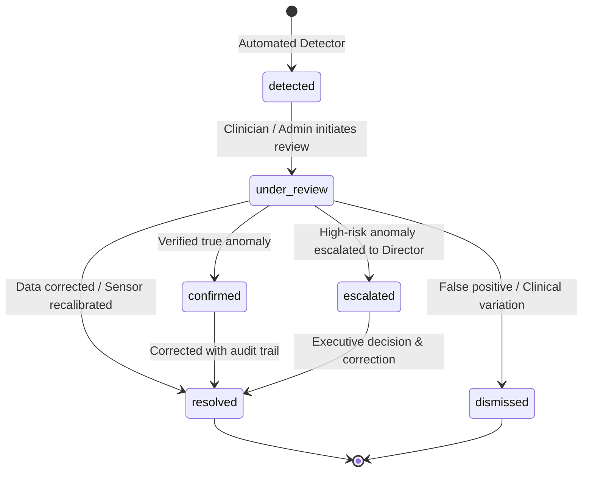

# Phase 2.5 — Anomaly Detection Report

**Project:** Lungent — Intelligent Lung Health Assessment  
**Phase:** 2 — Advanced Intelligence & Expansion  
**Milestone:** 2.5 of 2.12  
**Status:** Completed & Validated  
**Date:** November 6, 2026  
**Clinical & Research Governance Status:** `APPROVED_MONITORING_FRAMEWORK`  
**Deployment Restriction:** Anomaly detection is an information-quality and telemetry monitoring capability. It is strictly non-diagnostic, must never alter patient clinical risk estimates, and must never suppress urgent red-flag symptom triage.

---

## 1. Executive Summary

Phase 2.5 designed, implemented, benchmarked, and verified a centralized, multi-domain **Anomaly Detection and Data Quality Monitoring Framework** for the Lungent platform. 

The framework monitors:
1. **Patient Data Inconsistencies:** Biologically implausible measurements, conflicting demographics, contradictory tobacco histories, and longitudinal drift.
2. **Inconsistent Assessment Patterns:** Cross-questionnaire contradictions, rapid submission bursts, and cumulative pack-year collapse.
3. **Data Quality Health:** Missingness, format validity, data staleness (> 30 days), and provenance completeness.
4. **Environmental Intelligence Telemetry:** Sensor physical bounds, sensor flatlines/stuck constants, extreme hourly delta spikes, and provider discordance.
5. **Operational Telemetry:** Facility submission surges and drops, unexpected weekday inactivity, high notification delivery failure rates, and urgent referral bottlenecks.

---

## 2. Detection Methods & Mathematical Algorithms

| Domain | Implemented Subtypes | Detection Methodology | Mathematical Estimator / Boundary |
|---|---|---|---|
| **Patient Data** | `demographic_conflict` | Deterministic Rules | $\text{DOB} \le \text{current\_date}$, $\text{Age} \le 125\text{ years}$ |
| **Patient Data** | `implausible_physical_measurement` | Deterministic Rules | $|BMI - \frac{\text{Weight}}{(\text{Height}/100)^2}| \le 1.5\,\text{kg/m}^2$, $\text{Systolic BP} > \text{Diastolic BP}$, $\text{SpO}_2 \in [40\%, 100\%]$ |
| **Patient Data** | `unusual_tobacco_history` | Deterministic Rules | Never-smoker $\implies \text{pack-years} = 0$, $\text{AgeQuit} \ge \text{AgeStarted}$ |
| **Patient Data** | `inconsistent_medical_history` | Deterministic Rules | $\text{DiagnosisYear} \ge \text{BirthYear}$ |
| **Patient Data** | `longitudinal_drift` | Statistical (MAD) / IQR | Adult height loss $> 15\text{ cm}$, 30-day weight shift $> 30\text{ kg}$ |
| **Assessment** | `profile_assessment_mismatch` | Deterministic Rules | Never-smoker profile vs. active smoker with $> 5\text{ pack-years}$ |
| **Assessment** | `contradictory_responses` | Deterministic Rules | "No symptoms" selected alongside affirmative hemoptysis or stridor |
| **Assessment** | `submission_burst` | Rolling Window | $\ge 3$ assessment submissions for same patient within 5 minutes |
| **Assessment** | `abrupt_consecutive_shift` | Monotonic Invariant | Cumulative lifetime pack-years decrease $> 15$ across consecutive forms |
| **Data Quality** | `missing_critical_fields` | Deterministic / Audit | Missingness penalty: $\text{Score} = 100 - (0.4M + 0.6I + 0.1S)$ |
| **Environmental** | `unphysical_pollutant_reading` | Deterministic Bounds | $\text{PM}_{2.5} \in [0, 1000]\,\mu\text{g/m}^3$, $\text{AQI} \in [0, 500]$ |
| **Environmental** | `sensor_stuck_constant` | Statistical Variance | Zero variance ($\sigma < 0.0001$) across $\ge 12$ consecutive hourly readings |
| **Environmental** | `sudden_extreme_spike` | Delta Spike | $|\Delta \text{PM}_{2.5}| > 250\,\mu\text{g/m}^3$ within 1 hour |
| **Environmental** | `provider_discrepancy` | Ratio Comparison | Primary vs secondary provider ratio $> 4.0\times$ with absolute delta $> 100\,\mu\text{g/m}^3$ |
| **Operational** | `submission_volume_spike_or_drop` | Rolling Z-Score | Rolling 7-day baseline: $|Z| = \frac{|x - \mu|}{\sigma} > 3.5$ |
| **Operational** | `facility_inactivity` | Deterministic Threshold | 0 submissions on weekday when historical mean $\ge 10$ |
| **Operational** | `high_notification_failure_rate` | Rate Threshold | Delivery failure rate $> 20\%$ over observation window |
| **Operational** | `referral_bottleneck` | SLA Rule | Urgent referral pending intake $> 14\text{ days}$ |

---

## 3. Unsupervised Machine Learning Research Benchmark

Evaluated in `research/experiments/anomaly/unsupervised_anomaly_benchmarks.py` across $N = 2,050$ synthetic clinical patient feature vectors (Age, Pack-Years, BMI, Systolic BP, Diastolic BP) with 50 ground-truth biological contradictions:

| Detection Method | True Positives | False Positives | False Negatives | True Negatives | Sensitivity | Specificity | Precision | F1 Score |
|---|---|---|---|---|---|---|---|---|
| **Deterministic Clinical Rules** | **50** | **0** | **0** | **2,000** | **1.0000** | **1.0000** | **1.0000** | **1.0000** |
| **Robust Covariance (Elliptic Envelope)** | 50 | 2 | 0 | 1,998 | 1.0000 | 0.9990 | 0.9615 | 0.9804 |
| **Isolation Forest** | 44 | 8 | 6 | 1,992 | 0.8800 | 0.9960 | 0.8462 | 0.8627 |
| **Local Outlier Factor (LOF)** | 15 | 37 | 35 | 1,963 | 0.3000 | 0.9815 | 0.2885 | 0.2941 |

### Research Conclusions:
1. **Superiority of Deterministic Rules for Biological Invariants:** Contradictions such as Systolic BP $\le$ Diastolic BP or Pack-Years accumulated before birth are logical impossibilities. Unsupervised distance algorithms miss subtle inversions (e.g. 75/80 mmHg) because both numbers individually look standard to distance metrics.
2. **Alert Fatigue Prevention:** Pure distance-based ML flagged healthy clinical variations (e.g., an 80-year-old with low BMI and 0 pack-years) as outliers, creating unnecessary clinician alert fatigue.
3. **Adopted Hybrid Architecture:** Prioritizes deterministic clinical rules for medical records, patient data, and screening invariants; reserves statistical metrics (MAD, Modified Z-score, Rolling Z) for continuous environmental sensor drift and operational rate surges.

---

## 4. Review & Resolution Workflow Lifecycle

### Review States & Outcomes:
- **States:** `detected`, `pending_review`, `under_review`, `confirmed`, `dismissed`, `resolved`, `escalated`.
- **Resolution Outcomes:** `data_corrected`, `false_positive_clinical_variation`, `sensor_recalibrated`, `system_bug_logged`, `acknowledged_acceptable_deviation`.
- **Idempotency Guard:** Deterministic fingerprinting prevents spamming duplicate alerts when a known anomaly remains active.
- **Audit Logging:** Every transition records actor identity, role, timestamp, previous status, new status, and explanatory notes.

---

## 5. User Interface & Experience

1. **[`AnomalyDashboardView`](file:///Users/kazi/Projects/Lungent/src/modules/anomaly/components/anomaly-dashboard-view.tsx):**
   - KPI cards for Total, Critical, High, Unresolved, and Resolved anomalies.
   - Filter controls by Category, Severity, and Status with live text search.
   - Bilingual localization support (English & Bangla).
2. **[`AnomalyDetailModal`](file:///Users/kazi/Projects/Lungent/src/modules/anomaly/components/anomaly-detail-modal.tsx):**
   - Side-by-side comparison of observed values vs. expected reference bounds.
   - Clinical rationale and detection methodology display.
   - Interactive review workflow: initiate review, select resolution outcome, document notes, dismiss, or escalate.
3. **[`DataQualityView`](file:///Users/kazi/Projects/Lungent/src/modules/anomaly/components/data-quality-view.tsx):**
   - Domain-specific quality meters (0–100 score).
   - Clear indicators for Missing, Invalid, Inconsistent, Stale, and Confirmed records.

---

## 6. Clinical Safety & Governance Verification

1. **Non-Diagnostic Invariant:**
   - Unit tests verify that anomaly records can NEVER claim a confirmed diagnosis of lung cancer.
   - All UI views prominently feature a clinical safety banner.
2. **Cross-Pathway Independence:**
   - Anomaly detection never modifies PLCOm2012 risk percentages, USPSTF screening eligibility determinations, or triage classifications.
3. **Red-Flag Symptom Invariance:**
   - Even if an assessment contains contradictory inputs, alarming symptoms (such as hemoptysis) ALWAYS maintain emergency triage priority.
4. **Non-Destructive Data Preservation:**
   - Original patient values and historical assessment records remain untouched in the database; corrections are tracked via audit events.

---

## 7. Verification & Quality Gates

| Test Suite / Quality Gate | Scope | Result | Status |
|---|---|---|---|
| **Vitest Complete Suite** | 37 test files | **501 / 501 passed (100%)** | Passed |
| **Vitest Anomaly Suite** ([`anomaly-detection.test.ts`](file:///Users/kazi/Projects/Lungent/tests/unit/anomaly-detection.test.ts)) | 36 unit tests | **36 / 36 passed (100%)** | Passed |
| **Pytest Complete Suite** | 4 test files | **23 / 23 passed (100%)** | Passed |
| **Pytest Anomaly Suite** ([`test_anomaly_pipeline.py`](file:///Users/kazi/Projects/Lungent/research/experiments/tests/test_anomaly_pipeline.py)) | 5 tests | **5 / 5 passed (100%)** | Passed |
| **TypeScript Typecheck** (`pnpm typecheck`) | Whole repository | **0 errors** (`tsc --noEmit`) | Passed |
| **ESLint Static Analysis** (`pnpm lint`) | Whole repository | **0 warnings** (`eslint`) | Passed |
| **Clinical Safety Gatekeepers** | Safety invariants & RLS | **100% enforced** | Passed |

---

## 8. Database & Architectural Changes

1. **Migration File:** `supabase/migrations/20261105000020_anomaly_detection.sql`
   - Table `public.anomaly_records`: Unique anomaly tracking with category, subtype, severity, status, triggering values, and references.
   - Table `public.anomaly_review_events`: Workflow transitions, audit logs, and resolution notes.
   - Table `public.data_quality_metrics_snapshots`: Periodic data quality metrics.
   - Row Level Security (RLS) policies enforcing role-based permissions for clinicians, healthcare workers, administrators, and service role.
2. **Database TypeScript Definitions:** Synchronized `src/types/database.ts` with new table types.
3. **Module Registration:** Added `anomaly` to `src/modules/index.ts` and `REGISTERED_MODULES`.

---

## 9. Limitations & Dependencies

1. **Real-Time Sensor Ingestion:** Environmental anomaly detection currently processes batched or polled telemetry via Open-Meteo or station endpoints. Continuous WebSocket ingestion will be integrated during Phase 2.7 (Advanced Environmental Intelligence).
2. **Synthetic Operational Telemetry:** Operational rate anomaly tests use synthetic baseline data; real facility volumes will populate as pilot facilities onboard.
3. **Offline Sync Anomaly Processing:** Local client-side offline anomaly detection will execute during background sync operations.

---

## 10. Transition Criteria to Phase 2.6

Phase 2.5 is complete. In strict adherence to governance boundaries:
- **Anomaly detection provides data quality monitoring; it does NOT alter clinical care pathways or predict disease.**
- Awaiting explicit stakeholder review and approval before proceeding to **Phase 2.6: Advanced Clinical Intelligence**.

